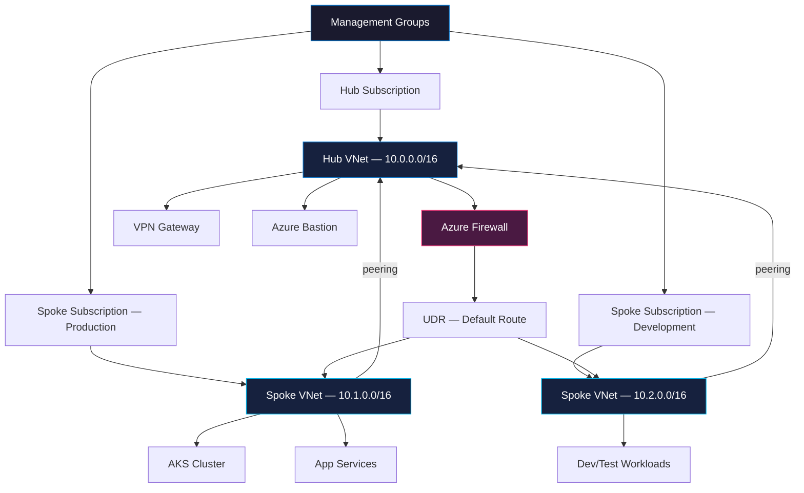

# Azure Cloud Engineer Portfolio

  &nbsp;
  &nbsp;
  &nbsp;
  

---

## Architecture — Hub & Spoke Topology

---

## Tech Stack

  <strong>Azure Services</strong>  
  
    
  &nbsp;
  &nbsp;
  &nbsp;
  &nbsp;
  &nbsp;
  &nbsp;
  &nbsp;
  &nbsp;
  &nbsp;
  

  <strong>Tools & Languages</strong>  
  
    
  

---

## Current Focus

🏗️ **Azure Landing Zones & Enterprise-Scale Architecture** — Production-grade multi-subscription topologies with policy-driven governance.

☸️ **AKS & Cloud-Native Workloads** — Hardened clusters, service mesh, GitOps delivery with Flux.

🔐 **DevSecOps & Zero Trust on Azure** — Identity-centric security, private endpoints everywhere, shift-left scanning in CI/CD.

---

## Featured Projects

| Repository | Description |
|---|---|
| [`azure-landing-zone-terraform`](https://github.com/azure-landing-zone-terraform) | Enterprise-scale landing zone — management groups, policy assignments, and connectivity |
| [`aks-production-cluster`](https://github.com/aks-production-cluster) | Production AKS with private API server, Workload Identity, and Azure CNI Overlay |
| [`azure-devops-cicd-pipelines`](https://github.com/azure-devops-cicd-pipelines) | Multi-stage YAML pipelines with environment approvals and template libraries |
| [`azure-serverless-event-pipeline`](https://github.com/azure-serverless-event-pipeline) | Event-driven architecture — Event Grid, Functions, Service Bus, Cosmos DB |
| [`azure-observability-stack`](https://github.com/azure-observability-stack) | Centralized monitoring with Azure Monitor, Log Analytics, Grafana, and alert routing |
| [`azure-cost-governance`](https://github.com/azure-cost-governance) | FinOps tooling — budgets, anomaly detection, and automated right-sizing recommendations |
| [`azure-zero-trust-architecture`](https://github.com/azure-zero-trust-architecture) | Zero Trust reference — Conditional Access, Private Link, NSG flow logs, and Defender for Cloud |
| [`azure-bicep-module-library`](https://github.com/azure-bicep-module-library) | Reusable Bicep modules with versioned registry publishing and validation tests |
