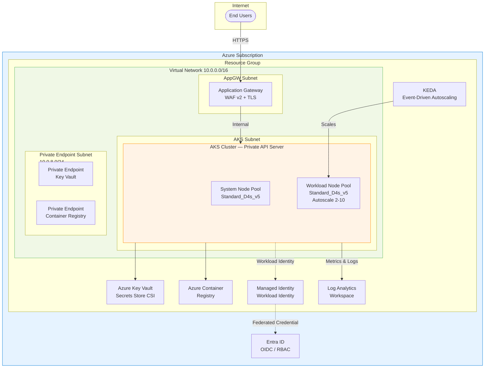

# AKS Production Cluster

Production-grade Azure Kubernetes Service (AKS) deployment with enterprise security, networking, and observability patterns.

## Architecture



## Azure Services

| Service | Purpose |
|---------|---------|
| **AKS** | Managed Kubernetes with private API server and Azure CNI Overlay |
| **Application Gateway** | Ingress controller (AGIC) with WAF v2 and TLS termination |
| **Key Vault** | Secrets management via Secrets Store CSI Driver |
| **Container Registry** | Private container image storage |
| **Managed Identity** | Passwordless authentication with Workload Identity federation |
| **Log Analytics** | Centralized logging and monitoring for cluster diagnostics |
| **Virtual Network** | Network isolation with NSGs and private endpoints |
| **KEDA** | Event-driven pod autoscaling beyond CPU/memory metrics |

## Prerequisites

- [Terraform](https://developer.hashicorp.com/terraform/downloads) >= 1.5
- [Azure CLI](https://learn.microsoft.com/en-us/cli/azure/install-azure-cli) >= 2.50
- [kubectl](https://kubernetes.io/docs/tasks/tools/) >= 1.28
- [Helm](https://helm.sh/docs/intro/install/) >= 3.12
- Azure subscription with **Owner** or **Contributor + User Access Administrator** roles
- A registered Azure AD application for GitHub Actions OIDC

## Quick Start

```bash
# Authenticate
az login
az account set --subscription "<SUBSCRIPTION_ID>"

# Initialize and deploy (dev)
cd terraform
terraform init -backend-config=../environments/dev.tfvars
terraform plan -var-file=../environments/dev.tfvars -out=tfplan
terraform apply tfplan

# Get cluster credentials
az aks get-credentials \
  --resource-group "rg-aks-dev-eastus" \
  --name "aks-dev-eastus" \
  --admin

# Deploy sample app
helm upgrade --install sample-app ../helm/sample-app \
  --namespace sample-app --create-namespace \
  --values ../helm/sample-app/values.yaml
```

## Environments

| Environment | File | API Server | Node Count |
|-------------|------|------------|------------|
| Development | `environments/dev.tfvars` | Public (for ease of dev) | 1–3 |
| Production | `environments/prod.tfvars` | Private | 2–10 |

## CI/CD

The GitHub Actions workflow (`.github/workflows/deploy.yml`) uses **OIDC federation** to authenticate with Azure — no secrets stored in GitHub. It runs `terraform plan` on PRs and `terraform apply` on merges to `main`.

## Project Structure

```
aks-production-cluster/
├── terraform/           # Infrastructure as Code
│   ├── main.tf          # Resource group, tagging, data sources
│   ├── variables.tf     # Input variable declarations
│   ├── outputs.tf       # Exported values for downstream use
│   ├── providers.tf     # Provider versions and configuration
│   ├── backend.tf       # Remote state in Azure Storage
│   ├── aks.tf           # AKS cluster and node pools
│   ├── networking.tf    # VNet, subnets, NSGs
│   ├── identity.tf      # Managed Identity + Workload Identity
│   └── keyvault.tf      # Key Vault + CSI driver integration
├── helm/sample-app/     # Helm chart for a sample microservice
├── manifests/           # Raw K8s manifests (KEDA, CSI)
├── .github/workflows/   # CI/CD pipeline
└── environments/        # Per-environment variable overrides
```

## Skills Demonstrated

- **Infrastructure as Code** — Terraform modules with remote state and environment separation
- **Kubernetes** — AKS cluster design, Helm charts, KEDA autoscaling, RBAC
- **Networking** — Azure CNI Overlay, private endpoints, NSGs, Application Gateway
- **Security** — Workload Identity, Key Vault CSI, private API server, managed identities, zero hardcoded secrets
- **CI/CD** — GitHub Actions with OIDC federation, plan/apply workflow
- **Observability** — Log Analytics integration, Container Insights
- **Cost Management** — Node pool autoscaling, resource tagging strategy
