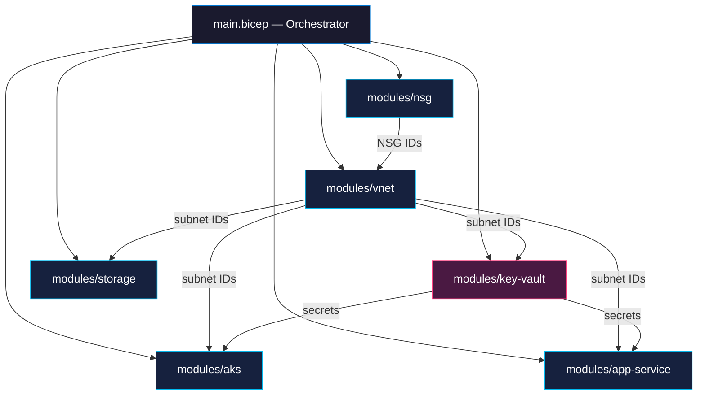

# Azure Bicep Module Library

Reusable, production-grade Bicep modules following [Azure Verified Modules](https://aka.ms/avm) patterns. Each module enforces security defaults — private endpoints, managed identities, RBAC — so consumers get a hardened baseline without extra work.

---

## Architecture



---

## Modules

| Module | Description |
|--------|-------------|
| [`vnet`](modules/vnet/) | Virtual Network with configurable subnets, NSG association, and DDoS protection |
| [`nsg`](modules/nsg/) | Network Security Group with default deny-all and common allow rules |
| [`aks`](modules/aks/) | Production AKS with Azure CNI, Workload Identity, Defender, and Key Vault CSI |
| [`app-service`](modules/app-service/) | App Service with VNet integration, managed identity, and staging slots |
| [`key-vault`](modules/key-vault/) | Key Vault with RBAC authorization, purge protection, and private endpoint |
| [`storage`](modules/storage/) | Storage Account with lifecycle rules, versioning, and private endpoint |

---

## Prerequisites

- Azure CLI ≥ 2.50 with Bicep CLI
- An Azure subscription with Contributor + User Access Administrator
- (Optional) Private DNS Zones for private endpoint resolution

```bash
az bicep install
az bicep version   # confirm ≥ 0.22
```

---

## Usage

### Deploy all modules via orchestrator

```bash
# Validate
az deployment sub what-if \
  --location eastus2 \
  --template-file main.bicep \
  --parameters environments/dev.bicepparam

# Deploy
az deployment sub create \
  --location eastus2 \
  --template-file main.bicep \
  --parameters environments/prod.bicepparam
```

### Use a single module

```bicep
module kv 'modules/key-vault/main.bicep' = {
  name: 'keyvault-deploy'
  params: {
    location: 'eastus2'
    keyVaultName: 'kv-myapp-prod'
    adminObjectId: '00000000-0000-0000-0000-000000000000'
    tags: { environment: 'prod', project: 'myapp' }
  }
}
```

---

## CI/CD

| Workflow | Trigger | Action |
|----------|---------|--------|
| `validate.yml` | Pull request | Runs `az deployment sub what-if` and posts results as PR comment |
| `deploy.yml` | Merge to `main` | Deploys to dev, then prod with manual approval gate |

Both workflows authenticate via **OIDC Federated Credentials** — no stored secrets.

---

## Skills Demonstrated

- **Bicep IaC** — Modular, parameterized, linted infrastructure code
- **Azure Networking** — VNets, NSGs, private endpoints, service endpoints
- **Security** — RBAC, Key Vault, private endpoints, TLS 1.2, no shared keys
- **FinOps** — Storage lifecycle rules, right-sized SKUs per environment
- **CI/CD** — What-If validation on PR, progressive deployment with approvals
