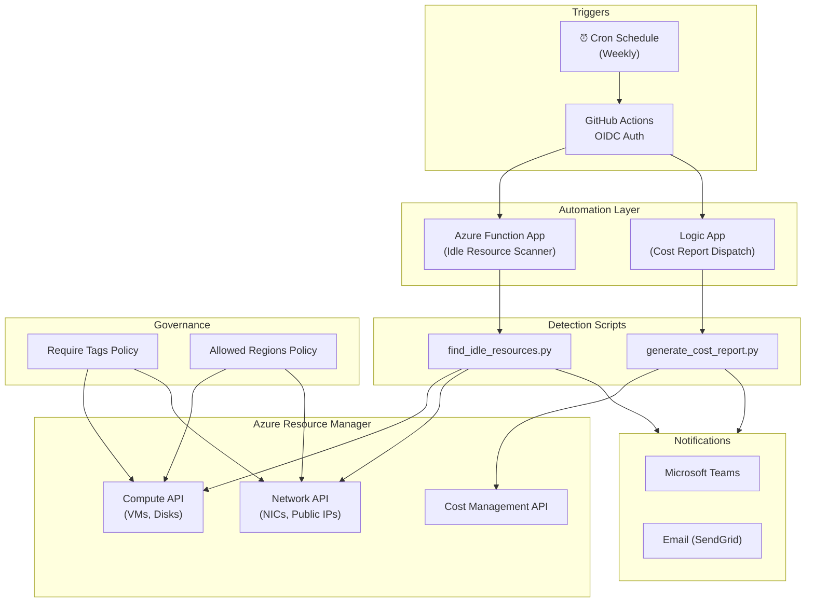

# Azure Cost Governance & Optimization

Automated cost management, idle-resource detection, and policy enforcement for Azure subscriptions.

## Architecture



## Azure Services Used

| Service | Purpose |
|---------|---------|
| **Azure Functions** | Scheduled idle-resource detection |
| **Logic Apps** | Orchestrate weekly cost-report delivery |
| **Cost Management API** | Query spend by resource group and service |
| **Azure Policy** | Enforce tagging and region restrictions |
| **Managed Identity** | Passwordless authentication for automation |
| **Key Vault** | Store notification webhook URLs |
| **Storage Account** | Function App backing store & report archive |

## Prerequisites

- **Azure Subscription** with Owner or Contributor + User Access Administrator roles
- **Terraform** ≥ 1.5
- **Python** ≥ 3.10
- **Azure CLI** ≥ 2.50 (for local testing)
- **GitHub** repository with OIDC federation configured for Azure

### OIDC Federation Setup

```bash
# Create the federated credential for GitHub Actions
az ad app create --display-name "github-cost-governance"
az ad sp create --id <APP_ID>
az ad app federated-credential create --id <APP_ID> --parameters '{
  "name": "github-deploy",
  "issuer": "https://token.actions.githubusercontent.com",
  "subject": "repo:<ORG>/<REPO>:ref:refs/heads/main",
  "audiences": ["api://AzureADTokenExchange"]
}'
```

## Quick Start

```bash
# 1. Install Python dependencies
pip install -r scripts/requirements.txt

# 2. Authenticate (local development)
az login

# 3. Run idle resource detection
python scripts/find_idle_resources.py --subscription-id <SUB_ID>

# 4. Generate a cost report
python scripts/generate_cost_report.py --subscription-id <SUB_ID> --days 7

# 5. Deploy infrastructure
cd infra
terraform init
terraform plan -var-file="../environments/dev.tfvars"
terraform apply -var-file="../environments/dev.tfvars"
```

## Project Structure

```
azure-cost-governance/
├── scripts/                  # Python automation scripts
│   ├── find_idle_resources.py
│   ├── generate_cost_report.py
│   └── requirements.txt
├── infra/                    # Terraform IaC
│   ├── main.tf
│   ├── variables.tf
│   ├── outputs.tf
│   ├── providers.tf
│   ├── policies.tf
│   ├── logic-app.tf
│   └── function.tf
├── policies/                 # Custom Azure Policy definitions
│   ├── require-tags.json
│   └── allowed-regions.json
├── .github/workflows/        # CI/CD pipelines
│   ├── deploy.yml
│   └── cost-report.yml
└── environments/             # Per-environment variable files
    ├── dev.tfvars
    └── prod.tfvars
```

## Usage

### Detect Idle Resources

```bash
python scripts/find_idle_resources.py \
  --subscription-id "00000000-0000-0000-0000-000000000000" \
  --output json
```

The script scans for:

| Resource Type | Idle Condition |
|---------------|---------------|
| Virtual Machines | Power state is **deallocated** (still incurs disk charges) |
| Managed Disks | **Unattached** — no owning VM |
| Network Interfaces | **Not attached** to any VM |
| Public IP Addresses | **Not associated** with any NIC or load balancer |

### Generate Cost Report

```bash
python scripts/generate_cost_report.py \
  --subscription-id "00000000-0000-0000-0000-000000000000" \
  --days 7 \
  --output table
```

Produces a cost breakdown grouped by resource group and service name.

## Skills Demonstrated

- **FinOps Practices** — automated cost visibility and waste detection
- **Azure SDK for Python** — production-quality scripts with type hints and structured logging
- **Azure Policy** — governance-as-code for tag and region enforcement
- **Terraform** — modular IaC for Functions, Logic Apps, and Policy assignments
- **Managed Identity** — zero-secret authentication following least-privilege
- **GitHub Actions + OIDC** — keyless CI/CD deployment to Azure
- **Mermaid Diagrams** — architecture-as-code documentation
