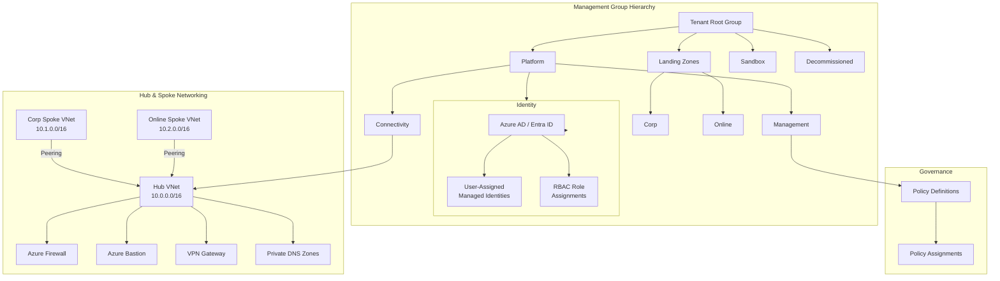

# Azure Landing Zone — Terraform

Production-ready **Azure Landing Zone** implementing Microsoft's Cloud Adoption Framework (CAF) enterprise-scale architecture with Terraform. This project provisions the foundational platform — management group hierarchy, governance policies, hub-spoke networking, and identity — so workload teams can deploy into a secure, compliant environment from day one.

## Architecture



## Azure Services

| Service | Purpose |
|---|---|
| **Management Groups** | Hierarchical governance scope aligned to CAF |
| **Azure Policy** | Guardrails — enforce tagging, allowed regions, SKU restrictions |
| **Virtual Network (Hub)** | Centralised networking with shared services |
| **VNet Peering** | Hub-to-spoke connectivity with gateway transit |
| **Azure Firewall** | Layer-4/7 network filtering and FQDN-based rules |
| **Azure Bastion** | Secure, browser-based VM access without public IPs |
| **Private DNS Zones** | Name resolution for Private Endpoints |
| **User-Assigned Managed Identity** | Passwordless authentication for platform automation |
| **Azure Storage (remote state)** | Terraform state with locking via blob lease |

## Prerequisites

| Requirement | Minimum Version |
|---|---|
| [Terraform](https://developer.hashicorp.com/terraform/downloads) | >= 1.6.0 |
| [Azure CLI](https://learn.microsoft.com/cli/azure/install-azure-cli) | >= 2.55.0 |
| Azure subscription with **Owner** or **User Access Administrator** at tenant root |
| GitHub repo with OIDC federated credentials configured for `AzureRM` |

## Quick Start

```bash
# 1. Authenticate
az login --tenant <TENANT_ID>

# 2. Initialise remote backend
terraform init -backend-config="environments/dev.tfvars"

# 3. Select workspace
terraform workspace select dev || terraform workspace new dev

# 4. Plan
terraform plan -var-file="environments/dev.tfvars" -out=tfplan

# 5. Apply
terraform apply tfplan
```

## Environments

| File | Purpose |
|---|---|
| `environments/dev.tfvars` | Development — smaller SKUs, relaxed policies |
| `environments/staging.tfvars` | Staging — production-like, cost-optimised |
| `environments/prod.tfvars` | Production — HA, full policy enforcement |

## CI / CD

The included GitHub Actions workflow (`.github/workflows/terraform.yml`) uses **OIDC federated credentials** — no client secrets are stored in the repository. The pipeline runs `plan` on every pull request and `apply` on merge to `main`.

## Project Layout

```
.
├── main.tf                 # Root module — composes all child modules
├── variables.tf            # Input variables for the root module
├── outputs.tf              # Exported values (VNet IDs, policy IDs, …)
├── providers.tf            # AzureRM + AzureAD provider configuration
├── backend.tf              # Remote state in Azure Blob Storage
├── modules/
│   ├── management-groups/  # CAF-aligned management group tree
│   ├── policy-assignments/ # Built-in & custom policy assignments
│   ├── connectivity/       # Hub VNet, Firewall, Bastion, DNS, Peering
│   └── identity/           # Managed Identities & RBAC
├── environments/           # Per-environment variable overrides
└── .github/workflows/      # CI/CD pipeline
```

## Skills Demonstrated

- **Infrastructure as Code** — declarative, idempotent infrastructure with Terraform
- **Azure CAF / Enterprise-Scale** — management groups, policy-driven governance
- **Hub & Spoke Networking** — centralised egress, segmentation, DNS resolution
- **Zero-Trust Security** — Azure Firewall, Bastion, no public IPs on workloads
- **CI/CD & GitOps** — GitHub Actions with OIDC, plan-on-PR / apply-on-merge
- **State Management** — remote backend with locking, per-environment workspaces
- **Tagging & Cost Governance** — mandatory tags enforced via Azure Policy
- **Managed Identities** — passwordless service-to-service authentication

## License

MIT
