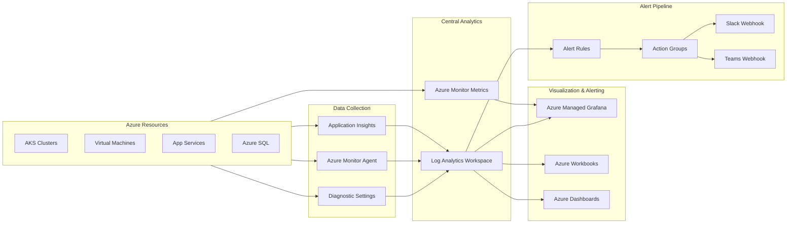

# Azure Observability Stack

Production-grade observability platform for Azure workloads, built with Terraform. Deploys a unified monitoring stack using Azure Monitor, Log Analytics, Azure Managed Grafana, and automated alerting with KQL-powered diagnostics.

## Architecture



## Azure Services Used

| Service | Purpose |
|---|---|
| **Azure Monitor** | Central telemetry pipeline for metrics, logs, and traces |
| **Log Analytics Workspace** | Centralized log storage and KQL query engine |
| **Azure Managed Grafana** | Visualization layer connected to Azure Monitor datasource |
| **Azure Workbooks** | Interactive Azure-native reports for AKS and VM health |
| **Alert Rules** | Scheduled and metric-based alerting on KQL query results |
| **Action Groups** | Notification routing to Slack, Teams, and email |
| **Azure Dashboard** | Portal-level overview dashboards |

## Prerequisites

- Azure subscription with `Owner` or `Contributor` + `Monitoring Contributor` roles
- Terraform >= 1.5
- Azure CLI >= 2.50
- A registered Azure AD application with federated credentials (for GitHub Actions OIDC)
- Slack incoming webhook URL and/or Microsoft Teams webhook URL for alert routing

## Quick Start

```bash
# Authenticate
az login
az account set --subscription <SUBSCRIPTION_ID>

# Initialize and deploy (dev)
cd infra
terraform init
terraform plan -var-file="../environments/dev.tfvars" -out=tfplan
terraform apply tfplan

# Deploy to production
terraform plan -var-file="../environments/prod.tfvars" -out=tfplan
terraform apply tfplan
```

## Project Structure

```
azure-observability-stack/
├── infra/                  # Terraform infrastructure-as-code
│   ├── main.tf             # Resource group, tagging, data sources
│   ├── variables.tf        # Input variables with validation
│   ├── outputs.tf          # Stack outputs (workspace ID, Grafana URL, etc.)
│   ├── providers.tf        # Provider configuration with required versions
│   ├── log-analytics.tf    # Log Analytics Workspace + solutions
│   ├── grafana.tf          # Azure Managed Grafana + role assignments
│   ├── alerts.tf           # Alert rules and action groups
│   └── dashboards.tf       # Azure portal dashboard resources
├── kql/                    # KQL query library
│   ├── aks-diagnostics.kql # AKS control plane + pod diagnostics
│   ├── vm-performance.kql  # VM CPU, memory, disk saturation queries
│   ├── app-service-errors.kql  # App Service HTTP errors + latency
│   └── cost-anomalies.kql  # Cost spike and anomaly detection
├── workbooks/              # Azure Workbook templates (ARM JSON)
│   ├── aks-overview.json   # AKS cluster health workbook
│   └── vm-health.json      # VM fleet health workbook
├── grafana/
│   └── dashboards/
│       └── azure-monitor-overview.json  # Grafana dashboard JSON
├── environments/           # Per-environment variable files
│   ├── dev.tfvars
│   └── prod.tfvars
└── .github/
    └── workflows/
        └── deploy.yml      # GitHub Actions with OIDC auth
```

## KQL Query Library

The `kql/` directory contains production-ready queries for common observability scenarios:

- **AKS Diagnostics** — Control plane errors, pod restart storms, OOMKilled containers, and node pressure conditions
- **VM Performance** — CPU saturation, available memory trending, disk IOPS bottlenecks, and heartbeat gaps
- **App Service Errors** — HTTP 5xx rates, slow dependency calls, failed request patterns by endpoint
- **Cost Anomalies** — Daily spend deviation detection, resource group cost spikes, idle resource identification

## Alerting Strategy

Alerts follow a severity-based routing model:

| Severity | Example | Channel |
|---|---|---|
| Sev 0 — Critical | Node NotReady, VM heartbeat lost | Slack + Teams + Email |
| Sev 1 — Error | Pod CrashLoopBackOff, HTTP 5xx spike | Slack + Teams |
| Sev 2 — Warning | CPU > 85% sustained, disk > 90% | Teams |
| Sev 3 — Informational | Cost anomaly detected, new deployment | Email |

## Skills Demonstrated

- **Infrastructure as Code** — Modular Terraform with environment-based deployments
- **Azure Monitor & Log Analytics** — Centralized observability across resource types
- **KQL (Kusto Query Language)** — Advanced log analytics, time-series analysis, anomaly detection
- **Azure Managed Grafana** — Enterprise dashboarding with Azure Monitor datasource integration
- **Automated Alerting** — Multi-severity alert pipeline with webhook-based notification routing
- **Azure Workbooks** — Interactive ARM-template-based diagnostic reports
- **CI/CD** — GitHub Actions with OIDC authentication for zero-secret deployments
- **Operational Best Practices** — Tagging strategy, retention policies, RBAC, cost controls

## License

MIT
