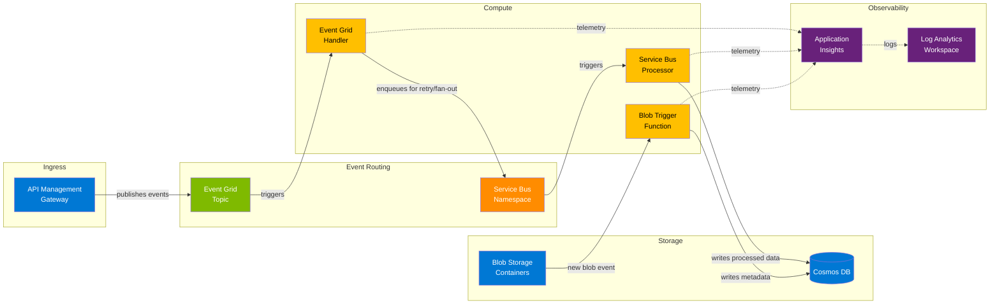

# Azure Serverless Event Pipeline

Production-grade, event-driven serverless architecture on Azure using Functions, Event Grid, Service Bus, Cosmos DB, and API Management — fully deployed with Terraform and secured with Private Endpoints and Managed Identities.

## Architecture



### Event Flow

1. **Ingestion** — External clients call the API Management gateway, which validates requests and publishes events to Event Grid.
2. **Routing** — Event Grid fans out events to the Event Grid Handler function with at-least-once delivery.
3. **Processing** — The handler enriches, validates, and forwards messages to a Service Bus queue for reliable, ordered processing.
4. **Persistence** — The Service Bus Processor writes final records to Cosmos DB with idempotent upserts.
5. **File Processing** — The Blob Trigger independently reacts to file uploads, extracts metadata, and writes to Cosmos DB.

## Azure Services

| Service | Role |
|---|---|
| **Azure Functions (Python 3.11)** | Serverless compute for event handlers |
| **Event Grid** | Pub/sub event routing with push delivery |
| **Service Bus** | Reliable message queuing with dead-letter support |
| **Cosmos DB (NoSQL)** | Low-latency document store with partition-key design |
| **API Management** | Gateway for authentication, throttling, and routing |
| **Blob Storage** | Raw file ingestion and Function App deployment |
| **Application Insights** | Distributed tracing and live metrics |
| **Key Vault** | Secrets management (referenced, never exposed) |
| **Managed Identity** | Passwordless service-to-service authentication |
| **Private Endpoints** | Network-level isolation for all data-plane traffic |

## Prerequisites

- [Terraform ≥ 1.5](https://developer.hashicorp.com/terraform/install)
- [Azure CLI ≥ 2.50](https://learn.microsoft.com/en-us/cli/azure/install-azure-cli)
- [Azure Functions Core Tools v4](https://learn.microsoft.com/en-us/azure/azure-functions/functions-run-local)
- [Python 3.11](https://www.python.org/downloads/)
- An Azure subscription with Contributor + User Access Administrator roles
- A GitHub repository with OIDC federation configured for Azure deployments

## Quick Start

### Local Development

```bash
# Clone and navigate
cd azure-serverless-event-pipeline

# Create a Python virtual environment
python -m venv .venv && source .venv/bin/activate

# Install dependencies
pip install -r src/requirements.txt

# Copy and populate local settings
cp src/local.settings.json.example src/local.settings.json
# Edit src/local.settings.json with your connection strings

# Start the Functions host
cd src && func start
```

### Infrastructure Deployment

```bash
cd infra

# Initialize Terraform
terraform init

# Plan against the dev environment
terraform plan -var-file="../environments/dev.tfvars" -out=tfplan

# Apply
terraform apply tfplan
```

### CI/CD

Push to the `main` branch to trigger the GitHub Actions workflow, which:
1. Runs `terraform plan` on pull requests
2. Runs `terraform apply` + deploys the Function App on merge to `main`

## Project Structure

```
azure-serverless-event-pipeline/
├── src/                        # Application code
│   ├── functions/              # Azure Function triggers
│   │   ├── blob_trigger/       # Reacts to Blob Storage uploads
│   │   ├── event_grid_handler/ # Processes Event Grid events
│   │   └── service_bus_processor/ # Consumes Service Bus messages
│   ├── host.json               # Functions host configuration
│   ├── local.settings.json.example
│   └── requirements.txt
├── infra/                      # Terraform infrastructure
│   ├── main.tf                 # Resource group, Key Vault, networking
│   ├── functions.tf            # Function App + App Service Plan
│   ├── storage.tf              # Storage Account + containers
│   ├── cosmosdb.tf             # Cosmos DB account + database
│   ├── messaging.tf            # Event Grid + Service Bus
│   ├── apim.tf                 # API Management gateway
│   ├── monitoring.tf           # Application Insights + Log Analytics
│   ├── variables.tf            # Input variables
│   ├── outputs.tf              # Output values
│   └── providers.tf            # Provider + backend configuration
├── environments/               # Per-environment variable files
│   ├── dev.tfvars
│   └── prod.tfvars
└── .github/workflows/
    └── deploy.yml              # CI/CD with OIDC authentication
```

## Skills Demonstrated

- **Event-Driven Architecture** — decoupled, asynchronous processing with Event Grid and Service Bus
- **Serverless Computing** — auto-scaling Azure Functions with consumption-based billing
- **Infrastructure as Code** — reproducible deployments with Terraform modules and state management
- **Zero-Trust Networking** — Private Endpoints for all data-plane communication
- **Identity & Access Management** — Managed Identities eliminate credential management
- **Observability** — end-to-end distributed tracing with Application Insights
- **API Governance** — centralized gateway with rate limiting, authentication, and versioning
- **CI/CD** — GitHub Actions with OIDC federation (no stored secrets)
- **NoSQL Data Modeling** — Cosmos DB partition key strategy for write-optimized workloads

## License

This project is provided as a portfolio demonstration. See [LICENSE](../LICENSE) for details.
