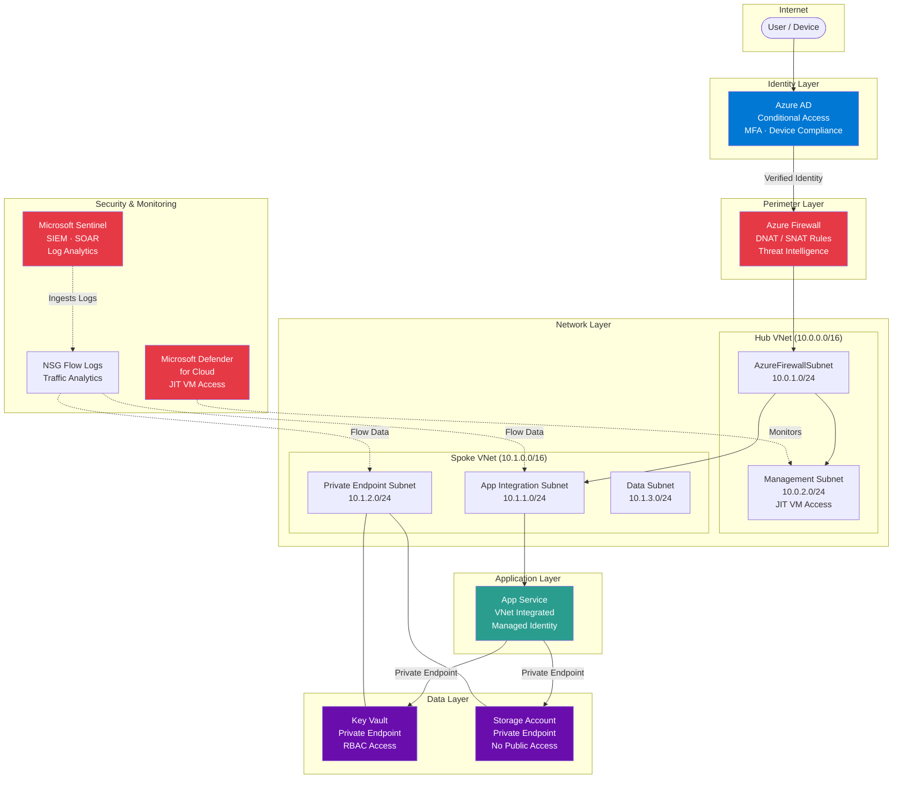

# Azure Zero Trust Architecture

Production-grade Zero Trust network implementation on Azure — no implicit trust, every request verified, least-privilege enforced everywhere.

## Architecture



## Zero Trust Principles Applied

| Principle | Implementation |
|---|---|
| **Verify explicitly** | Azure AD Conditional Access with MFA, device compliance, and risk-based policies |
| **Least-privilege access** | Managed Identities with scoped RBAC; no shared keys anywhere |
| **Assume breach** | Network micro-segmentation, NSG flow logs, Microsoft Sentinel SIEM, Defender for Cloud |
| **No public endpoints** | All PaaS services accessed exclusively via Private Endpoints |
| **Perimeter defense** | Azure Firewall with DNAT/SNAT rules and threat intelligence filtering |
| **Just-in-Time access** | JIT VM Access through Microsoft Defender — no standing admin ports |

## Azure Services

- **Azure AD & Conditional Access** — Identity verification and access control
- **Azure Firewall** — Centralized network filtering with policy-based rules
- **Azure Virtual Network** — Hub-spoke topology with micro-segmented subnets
- **Azure Private Link / Endpoints** — Private connectivity to all PaaS services
- **Azure App Service** — Web application with regional VNet integration
- **Azure Key Vault** — Secrets management with private endpoint and RBAC
- **Azure Storage** — Blob storage with private endpoint and no public access
- **Microsoft Defender for Cloud** — Cloud security posture management and JIT VM access
- **Microsoft Sentinel** — SIEM/SOAR with Log Analytics workspace
- **Network Security Groups** — Subnet-level traffic filtering with flow logs

## Prerequisites

- Azure subscription with **Owner** or **Contributor + User Access Administrator** roles
- Azure AD tenant with permissions to configure Conditional Access
- Terraform >= 1.5.0
- Azure CLI >= 2.50.0
- GitHub repository with OIDC federated credentials configured

## Usage

### 1. Configure Backend

Update `infra/backend.tf` with your Azure Storage Account details for remote state.

### 2. Set Variables

```bash
# Copy and customize the environment file
cp environments/dev.tfvars environments/local.tfvars
# Edit local.tfvars with your values
```

### 3. Deploy

```bash
cd infra

# Initialize Terraform with backend
terraform init -backend-config=../environments/dev.tfvars

# Plan with environment-specific variables
terraform plan -var-file=../environments/dev.tfvars -out=tfplan

# Apply
terraform apply tfplan
```

### 4. CI/CD

Push to `main` to trigger the GitHub Actions workflow, which authenticates via OIDC (no stored secrets) and deploys through plan → approve → apply stages.

## Post-Deployment

1. **Configure Conditional Access** — Follow [`docs/conditional-access-policies.md`](docs/conditional-access-policies.md) to set up AAD policies
2. **Validate Zero Trust** — Work through [`docs/zero-trust-checklist.md`](docs/zero-trust-checklist.md)
3. **Enable Sentinel rules** — Configure analytics rules in the Sentinel workspace for threat detection

## Skills Demonstrated

- **Zero Trust Architecture** — End-to-end implementation of Microsoft's Zero Trust model
- **Network Security** — Hub-spoke topology, NSGs, Azure Firewall, Private Endpoints
- **Identity & Access** — Azure AD Conditional Access, Managed Identities, RBAC
- **Threat Detection** — Microsoft Sentinel SIEM, Defender for Cloud, JIT access
- **Infrastructure as Code** — Modular Terraform with remote state and environment separation
- **CI/CD Security** — GitHub Actions with OIDC authentication (no stored credentials)
- **Cloud Governance** — Consistent tagging, least-privilege, defense-in-depth
